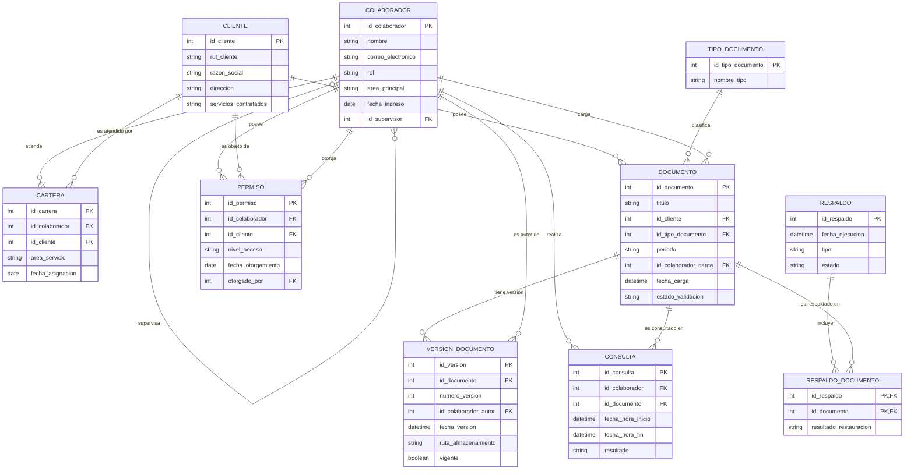
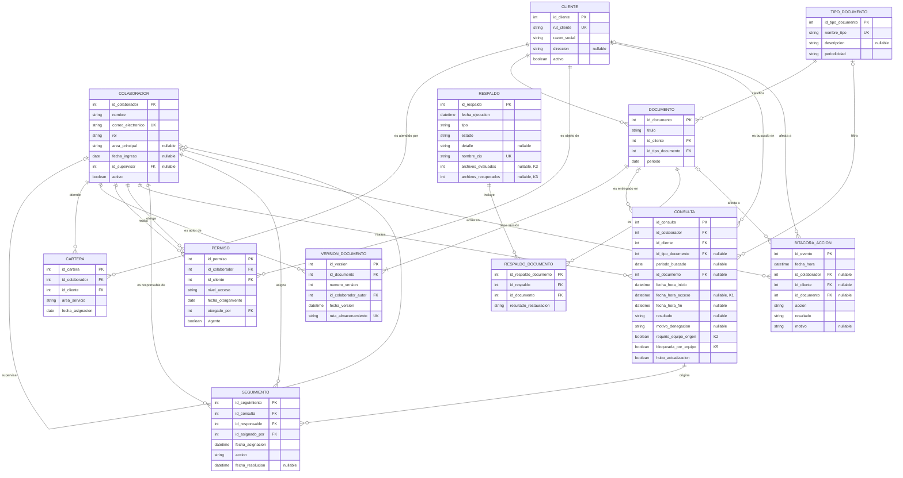

# 3. Modelo de datos de Integraltax Servicios Ltda. (Entrega 2)

**ICN292 Sistemas de Información para la Gestión · Universidad Técnica Federico Santa María · Paralelo 101**

Esta sección retoma el modelo entidad-relación (ER) preliminar de la Entrega 1 (E1), lo revisa y lo actualiza con lo que exige el proceso BPMN final y el respaldo programado de la E2, comprueba que esté normalizado hasta la tercera forma normal (3FN), justifica la normalización y las anomalías que evita, y termina con el diccionario de datos.

## Índice

3.1 Retomar el ER de la E1
3.2 Revisión y actualización del ER
3.3 Normalización hasta 3FN
3.4 Justificación de la normalización y anomalías que se evitan
3.5 Diccionario de datos
3.6 Supuestos y pendientes
Anexo. Documentación utilizada

---

## 3.1 Retomar el ER de la E1

### 3.1.1 Punto de partida

El ER preliminar de la E1 (sección E: Tabla 8, Tabla 9 y Figura 4) tiene **10 entidades** organizadas en cinco núcleos: asignación de clientes a colaboradores mediante carteras, repositorio documental (documento y versión), control de acceso (permiso), registro de consultas y respaldo programado. Cada núcleo sustenta una parte del proceso TO-BE y de los indicadores K1 a K5.

Como la Tabla 8 es la que sigue el resto de la E1 (trazabilidad de E.5, componentes de F.3) y la que usa la documentación del respaldo de la E2, se toma **como referencia** para este trabajo.

### 3.1.2 ER de la E1 (reconstruido desde la Tabla 8)

### 3.1.3 Relaciones de la E1

| Relación                   | Entidades                               | Cardinalidad                                                              |
| -------------------------- | --------------------------------------- | ------------------------------------------------------------------------- |
| Atiende                    | COLABORADOR, CARTERA, CLIENTE           | M:N, resuelta por CARTERA (atributos `area_servicio`, `fecha_asignacion`) |
| Supervisa                  | COLABORADOR con COLABORADOR             | 1:N (autorrelación)                                                       |
| Posee                      | CLIENTE → DOCUMENTO                     | 1:N                                                                       |
| Clasifica                  | TIPO_DOCUMENTO → DOCUMENTO              | 1:N                                                                       |
| Carga                      | COLABORADOR → DOCUMENTO                 | 1:N                                                                       |
| Tiene versión              | DOCUMENTO → VERSION_DOCUMENTO           | 1:N                                                                       |
| Es autor de                | COLABORADOR → VERSION_DOCUMENTO         | 1:N                                                                       |
| Otorga / posee permiso     | COLABORADOR, PERMISO, CLIENTE           | M:N, resuelta por PERMISO                                                 |
| Realiza                    | COLABORADOR → CONSULTA                  | 1:N                                                                       |
| Es consultado en           | DOCUMENTO → CONSULTA                    | 1:N                                                                       |
| Incluye / es respaldado en | RESPALDO, RESPALDO_DOCUMENTO, DOCUMENTO | M:N, resuelta por RESPALDO_DOCUMENTO                                      |

### 3.1.4 Inconsistencias internas de la E1

La Tabla 8 y la Figura 4 de la E1 no coinciden entre sí:

| Tabla              | Tabla 8 (texto)                                      | Figura 4 (diagrama)                                  |
| ------------------ | ---------------------------------------------------- | ---------------------------------------------------- |
| RESPALDO           | `fecha_ejecucion`, `tipo`, `estado`                  | `fecha_respaldo`, `ubicacion`                        |
| RESPALDO_DOCUMENTO | PK compuesta, `resultado_restauracion`               | PK propia `id_respaldo_documento`, `fecha_inclusion` |
| PERMISO            | `nivel_acceso`, `fecha_otorgamiento`, `otorgado_por` | `nivel_acceso`, `vigente`                            |
| CONSULTA           | `fecha_hora_inicio`, `fecha_hora_fin`, `resultado`   | sólo `fecha_consulta`                                |
| VERSION_DOCUMENTO  | `ruta_almacenamiento`, `vigente`                     | sin ruta ni vigente                                  |
| DOCUMENTO          | `periodo`, `estado_validacion`, datos de carga       | sin período ni estado                                |
| CLIENTE            | RUT, razón social, dirección, servicios              | `nombre`, `correo`                                   |

Además, dos indicadores están definidos de dos maneras dentro de la propia E1: K2 (sección B.6: "consultas independientes / total"; sección D.5.3: "resueltas con equipo de origen apagado / consultas autorizadas evaluadas") y K5 (B.6: un conteo de interrupciones; D.5.3: un porcentaje de consultas bloqueadas). El modelo actualizado registra una marca por consulta, que sirve para ambas definiciones.

---

## 3.2 Revisión y actualización del ER

### 3.2.1 Qué exige la E2 que el ER de la E1 no cubre

| Necesidad (fuente)                                                                                                                                         | Brecha en el ER de la E1                                                                                   |
| ---------------------------------------------------------------------------------------------------------------------------------------------------------- | ---------------------------------------------------------------------------------------------------------- |
| Un faltante debe registrarse **sin vincular un documento inexistente** (`02-bpmn.md`).                                                                     | `CONSULTA.id_documento` es obligatorio.                                                                    |
| La consulta pendiente debe ser visible para la directora y su cierre posterior, distinguible de la apertura (`02-bpmn.md`).                                | No hay criterios de búsqueda ni estados. Tampoco un seguimiento.                                           |
| Registro de acciones con actor, momento, objeto y resultado, también de los **rechazos** que no crean versión (`02-bpmn.md`; alcance IN y D.5.1 de la E1). | No existe ninguna entidad de auditoría.                                                                    |
| K1: tiempo entre el inicio de la búsqueda y el **acceso** al documento.                                                                                    | `fecha_hora_fin` mezcla el acceso con el cierre.                                                           |
| K2 y K5: registrar si se usó el computador de origen y si hubo interrupción por esa causa (E1, F.5.1).                                                     | No hay columnas para ello.                                                                                 |
| K3: archivos recuperados sobre archivos evaluados. Alerta con la causa de la falla (`05-automatizacion-n8n.md`).                                           | `RESPALDO_DOCUMENTO` guarda un resultado por documento, no por archivo. No se guarda la causa de la falla. |
| Participante "administración técnica" en el BPMN final.                                                                                                    | El rol sólo admite directora y colaborador.                                                                |

### 3.2.2 Cambios realizados al ER de la E1

| #   | Cambio                                                                                                                                                                                                                                                                                   | Motivo                                                                    |
| --- | ---------------------------------------------------------------------------------------------------------------------------------------------------------------------------------------------------------------------------------------------------------------------------------------- | ------------------------------------------------------------------------- |
| C1  | Nueva entidad **BITACORA_ACCION**                                                                                                                                                                                                                                                        | Auditoría de acciones y rechazos (ver tabla anterior).                    |
| C2  | Nueva entidad **SEGUIMIENTO**                                                                                                                                                                                                                                                            | La directora "revisa el pendiente y define el seguimiento" (BPMN E2).     |
| C3  | **CONSULTA**: `id_documento` pasa a ser opcional. Se agregan `id_cliente`, `id_tipo_documento`, `periodo_buscado`, `fecha_hora_acceso` (K1), `motivo_denegacion`, `requirio_equipo_origen` (K2), `bloqueada_por_equipo` (K5) y `hubo_actualizacion`. `resultado` queda con tres valores. | Faltantes, denegaciones, K1, K2 y K5.                                     |
| C4  | **RESPALDO**: se agregan `detalle`, `nombre_zip`, `archivos_evaluados` y `archivos_recuperados`.                                                                                                                                                                                         | Causa de la falla, ubicación de la copia y K3.                            |
| C5  | **CLIENTE**: se elimina `servicios_contratados`.                                                                                                                                                                                                                                         | Violación de 1FN y duplicado de `CARTERA.area_servicio` (ver 3.3).        |
| C6  | **DOCUMENTO**: `periodo` pasa de texto a fecha. Se eliminan `id_colaborador_carga`, `fecha_carga` y `estado_validacion`. La clave alterna pasa a ser cliente, tipo, período y título.                                                                                                    | 1FN y 3FN (ver 3.3).                                                      |
| C7  | **VERSION_DOCUMENTO**: se elimina `vigente` como columna (queda como vista). La ruta pasa a ser única.                                                                                                                                                                                   | 3FN. Evita dos versiones vigentes.                                        |
| C8  | **PERMISO**: se agrega `vigente` (tomado de la Figura 4 de la E1). `nivel_acceso` queda con dominio cerrado.                                                                                                                                                                             | Poder revocar sin perder el historial.                                    |
| C9  | **TIPO_DOCUMENTO**: se agrega `periodicidad`.                                                                                                                                                                                                                                            | Para interpretar la fecha de período.                                     |
| C10 | **COLABORADOR**: el rol admite también `administracion_tecnica`.                                                                                                                                                                                                                         | Actor del BPMN final.                                                     |
| C11 | **RESPALDO_DOCUMENTO**: clave propia con UNIQUE sobre el par (respaldo, documento).                                                                                                                                                                                                      | Compatibilidad con Django (ver 3.6). El script de respaldo inserta igual. |

La E1 incluía además `CARTERA`, la autorrelación `id_supervisor`, `area_principal`, `fecha_ingreso`, `direccion` y `otorgado_por`. Todos se **conservan**.

### 3.2.3 ER actualizado

**Cómo leer las cardinalidades:** `||` es exactamente uno, `o|` es cero o uno, `|{` es uno o más y `o{` es cero o más.

### 3.2.4 Explicación de las relaciones

| Relación                                                  | Cardinalidad              | Explicación                                                                                                         |
| --------------------------------------------------------- | ------------------------- | ------------------------------------------------------------------------------------------------------------------- |
| COLABORADOR supervisa a COLABORADOR                       | 0..1 a 0..N               | Cada colaborador tiene como máximo un supervisor (la directora, normalmente). La directora no tiene supervisor.     |
| COLABORADOR y CLIENTE, por CARTERA                        | N a M                     | Distribuye las carteras de clientes por área de servicio (remuneraciones, contabilidad, tributación).               |
| CLIENTE posee DOCUMENTO                                   | 1 a 0..N                  | Todo documento pertenece a un cliente.                                                                              |
| TIPO_DOCUMENTO clasifica DOCUMENTO                        | 1 a 0..N                  | La clasificación obligatoria de la carga.                                                                           |
| DOCUMENTO tiene VERSION_DOCUMENTO                         | 1 a 1..N                  | Un documento nace con su primera versión. Las actualizaciones agregan versiones sin borrar las anteriores.          |
| COLABORADOR es autor de VERSION_DOCUMENTO                 | 1 a 0..N                  | Trazabilidad de quién cargó o modificó.                                                                             |
| COLABORADOR y CLIENTE, por PERMISO                        | N a M                     | Autorización por cliente, con nivel de acceso.                                                                      |
| COLABORADOR otorga PERMISO                                | 1 a 0..N                  | Registra quién concedió cada permiso.                                                                               |
| COLABORADOR realiza CONSULTA                              | 1 a 0..N                  | Quién busca.                                                                                                        |
| CLIENTE es buscado en CONSULTA                            | 1 a 0..N                  | Cliente cuyo permiso se verifica. Permite registrar un faltante o una denegación sin documento.                     |
| TIPO_DOCUMENTO filtra CONSULTA                            | 0..1 a 0..N               | Criterio opcional de búsqueda.                                                                                      |
| DOCUMENTO es entregado en CONSULTA                        | 0..1 a 0..N               | **Opcional.** Sólo las consultas resueltas con documento lo vinculan.                                               |
| CONSULTA origina SEGUIMIENTO                              | 1 a 0..N                  | Sólo las consultas pendientes tienen seguimiento.                                                                   |
| COLABORADOR es responsable de / asigna SEGUIMIENTO        | 1 a 0..N (dos relaciones) | Responsable del seguimiento y la directora que lo define.                                                           |
| RESPALDO incluye DOCUMENTO, por RESPALDO_DOCUMENTO        | N a M                     | Resultado de la restauración de cada documento evaluado en cada ejecución.                                          |
| COLABORADOR / CLIENTE / DOCUMENTO afectan BITACORA_ACCION | 0..1 a 0..N               | Todas opcionales: la bitácora registra también acciones del sistema, rechazos sin versión y acciones sin documento. |

---

## 3.3 Normalización hasta 3FN

Se normaliza el ER actualizado, partiendo de lo que traía la E1. Cada forma normal se explica con los datos de Integraltax.

### 3.3.1 Primera forma normal (1FN)

Exige valores atómicos, sin grupos repetidos, y una clave primaria en cada tabla.

**Problemas detectados (en la E1)**

| Dónde                           | Problema                                                                                                  | Por qué importa en este caso                                                                                          |
| ------------------------------- | --------------------------------------------------------------------------------------------------------- | --------------------------------------------------------------------------------------------------------------------- |
| `CLIENTE.servicios_contratados` | Guarda una lista ("remuneraciones, contabilidad, tributación"). Es un grupo repetido en una sola columna. | No se podría buscar con fiabilidad "clientes con remuneraciones", y cada cambio obligaría a reescribir el texto.      |
| `DOCUMENTO.periodo` (texto)     | Sin formato definido: podría valer "2026", "03-2026" o "marzo 2026".                                      | La clasificación por período (RF04) y la búsqueda (RF05) fallarían, y no se detectarían duplicados escritos distinto. |

**Cambios realizados**

- Se elimina `servicios_contratados`. Los servicios de cada cliente quedan en `CARTERA.area_servicio`, una fila por cliente, colaborador y área.
- `periodo` pasa a **DATE** con el primer día del período (marzo de 2026 es `2026-03-01`; un documento anual es `2026-01-01`). `TIPO_DOCUMENTO.periodicidad` indica cómo leerlo. Lo mismo para `CONSULTA.periodo_buscado`.

**Justificación.** Una fila por servicio permite varios servicios por cliente sin listas. Una fecha es atómica y comparable.

**Revisado y sin problema**

- `VERSION_DOCUMENTO.ruta_almacenamiento` guarda un solo archivo por versión, que es lo que `respaldo.py` necesita.
- `COLABORADOR.rol` y `area_principal` son valores únicos por persona.
- Todas las tablas tienen clave primaria.

**Resultado.** Las 12 tablas están en 1FN.

### 3.3.2 Segunda forma normal (2FN)

Exige estar en 1FN y que ningún atributo dependa de una parte de una clave compuesta. Las tablas del modelo usan clave propia de una sola columna. Aun así, cada una tiene una **clave alterna compuesta**, y se revisa que sus atributos dependan de la clave completa:

| Tabla              | Clave alterna                                            | ¿Algún atributo depende de una parte?                            |
| ------------------ | -------------------------------------------------------- | ---------------------------------------------------------------- |
| VERSION_DOCUMENTO  | (`id_documento`, `numero_version`)                       | No. Autor, fecha y ruta describen **esa versión concreta**.      |
| PERMISO            | (`id_colaborador`, `id_cliente`)                         | No. Nivel, fecha, quien otorga y vigencia describen **ese par**. |
| CARTERA            | (`id_colaborador`, `id_cliente`, `area_servicio`)        | No. `fecha_asignacion` describe **esa asignación**.              |
| RESPALDO_DOCUMENTO | (`id_respaldo`, `id_documento`)                          | No. El resultado describe **ese documento en esa ejecución**.    |
| DOCUMENTO          | (`id_cliente`, `id_tipo_documento`, `periodo`, `titulo`) | No hay otros atributos.                                          |

**Problemas detectados.** Ninguno. El modelo cumple 2FN porque se separó DOCUMENTO de VERSION_DOCUMENTO. Si el cliente, el tipo y el período estuvieran en la versión, dependerían sólo de `id_documento` y se repetirían en cada actualización. Lo mismo ocurriría con `fecha_ejecucion` dentro de RESPALDO_DOCUMENTO, que depende sólo del respaldo.

**Cambios realizados.** Ninguno.

**Resultado.** El modelo está en 2FN.

### 3.3.3 Tercera forma normal (3FN)

Exige estar en 2FN y que ningún atributo no clave dependa de otro atributo no clave (ni se pueda derivar de otras filas).

**Problemas detectados (en la E1)**

| #   | Dónde                                            | Dependencia o redundancia                                                            | Por qué es un problema                                                                                        |
| --- | ------------------------------------------------ | ------------------------------------------------------------------------------------ | ------------------------------------------------------------------------------------------------------------- |
| 1   | `DOCUMENTO.id_colaborador_carga` y `fecha_carga` | Son el autor y la fecha de la **versión 1** del mismo documento.                     | Se guardan dos veces. Si se corrige una versión y no el documento, se contradicen.                            |
| 2   | `DOCUMENTO.estado_validacion`                    | En el proceso TO-BE, una carga inválida **no se almacena**: se corrige o se rechaza. | Todo documento guardado ya está validado, así que el atributo no discrimina. El rechazo queda en la bitácora. |
| 3   | `VERSION_DOCUMENTO.vigente`                      | La vigente es la de mayor `numero_version` del documento.                            | Hay que actualizar la versión anterior al cargar una nueva. Un error deja dos vigentes o ninguna.             |
| 4   | `CLIENTE.servicios_contratados`                  | Repite lo que ya dice `CARTERA.area_servicio`.                                       | Si cambia una y no la otra, se contradicen. (Ya eliminado en 1FN.)                                            |

**Cambios realizados**

- Se eliminan `id_colaborador_carga`, `fecha_carga` y `estado_validacion` de DOCUMENTO. El autor y la fecha de carga salen de la versión 1.
- Se elimina `vigente` de VERSION_DOCUMENTO. La versión vigente se obtiene con la vista `VW_VERSION_VIGENTE` (la de mayor `numero_version`).
- En las tablas nuevas se evitó crear columnas derivadas: no hay `estado` en CONSULTA ni en SEGUIMIENTO. El estado de una consulta (abierta, pendiente o cerrada) se obtiene con la vista `VW_CONSULTA_PENDIENTE`, y el del seguimiento sale de `fecha_resolucion`.

**Revisado y se mantiene**

- `CONSULTA.id_cliente` y `BITACORA_ACCION.id_cliente` repiten el cliente del documento cuando hay documento (`id_documento` → `id_cliente`). Se conservan porque un faltante, una denegación o un rechazo de carga **no tienen documento** y aun así hay que saber de qué cliente se trataba. La coherencia se garantiza con una regla (RN16).
- `CONSULTA.id_tipo_documento` y `periodo_buscado` son lo que se pidió buscar, no atributos del documento hallado. Sin documento, son lo único que describe el faltante.
- `RESPALDO.archivos_evaluados` y `archivos_recuperados` no se pueden derivar de RESPALDO_DOCUMENTO, que cuenta documentos y no archivos. K3 (el porcentaje) **no se guarda**: se calcula.
- `COLABORADOR.area_principal` es una declaración por persona, no se deduce de CARTERA.
- PERMISO y CARTERA se mantienen separados: la cartera dice quién atiende a cada cliente, y el permiso dice quién puede acceder a sus documentos. Son dos hechos distintos.
- `PERMISO.vigente` es un estado propio (no se deriva de otros datos).

**Resultado.** El modelo está en 3FN, con dos vistas como apoyo.

### 3.3.4 Resumen del proceso

| Etapa | Cambio                                                                                                                   |
| ----- | ------------------------------------------------------------------------------------------------------------------------ |
| 1FN   | Se elimina `servicios_contratados`. `periodo` y `periodo_buscado` pasan a DATE. Se agrega `TIPO_DOCUMENTO.periodicidad`. |
| 2FN   | Sin cambios.                                                                                                             |
| 3FN   | Se eliminan `id_colaborador_carga`, `fecha_carga`, `estado_validacion` y `vigente`. Se definen dos vistas.               |

Resultado: **12 tablas** (las 10 de la E1 más BITACORA_ACCION y SEGUIMIENTO).

---

## 3.4 Justificación de la normalización y anomalías que se evitan

Una anomalía es un error que aparece al insertar, modificar o borrar datos cuando una tabla mezcla hechos distintos. Estas son las que el modelo evita, con casos de Integraltax:

| Tipo              | Escenario                                                                                                                                            | Cómo lo evita el modelo                                                                                        |
| ----------------- | ---------------------------------------------------------------------------------------------------------------------------------------------------- | -------------------------------------------------------------------------------------------------------------- |
| **Inserción**     | Registrar un faltante cuando el colaborador no encuentra el documento. En la E1 `CONSULTA.id_documento` era obligatorio, así que no podía guardarse. | `id_documento` es opcional. La consulta guarda los criterios (cliente, tipo y período).                        |
| **Inserción**     | Dar de alta a un cliente que aún no ha entregado nada.                                                                                               | CLIENTE es independiente de DOCUMENTO.                                                                         |
| **Inserción**     | Registrar un rechazo de carga, que no crea documento ni versión.                                                                                     | BITACORA_ACCION lo guarda con su motivo.                                                                       |
| **Actualización** | Cambiar la razón social de un cliente.                                                                                                               | Está en un solo lugar (CLIENTE), no repetida en cada documento.                                                |
| **Actualización** | Dos versiones "vigentes" tras una carga que falla a medias.                                                                                          | La vigente se calcula (mayor `numero_version`), no se marca.                                                   |
| **Actualización** | Corregir quién cargó el documento y dejar dos autores distintos.                                                                                     | El autor está sólo en la versión.                                                                              |
| **Actualización** | Cambiar los servicios de un cliente y olvidar actualizar la lista.                                                                                   | Los servicios están sólo en CARTERA.                                                                           |
| **Actualización** | Escribir un mismo período de tres maneras ("03-2026", "marzo 2026") y no detectar duplicados.                                                        | `periodo` es una fecha única, con clave alterna (cliente, tipo, período, título).                              |
| **Eliminación**   | Borrar un documento y perder la evidencia de que fue respaldado o consultado.                                                                        | Todas las claves foráneas usan RESTRICT: no se puede borrar un documento con versiones, consultas o respaldos. |
| **Eliminación**   | Eliminar a un colaborador y perder quién cargó sus versiones.                                                                                        | Los usuarios se desactivan (`activo`), no se borran.                                                           |
| **Eliminación**   | Eliminar un permiso y perder quién lo otorgó.                                                                                                        | El permiso se revoca con `vigente`, y la acción queda en la bitácora.                                          |

**Por qué documento y versión van separados.** Cliente, tipo, período y título describen **al documento**, y la ruta y el autor describen **cada versión**. Separarlos permite conservar el historial de versiones que pide la entrevista ("recuperar versiones anteriores de una liquidación o declaración") sin repetir datos.

**Por qué se desnormaliza `id_cliente` en consultas y bitácora.** Es una redundancia deliberada y controlada: sin ella no se podría auditar un acceso denegado o un rechazo, que son justamente los casos que pide la trazabilidad.

---

## 3.5 Diccionario de datos

**Tipos de dato.** Son portables (`INT`, `VARCHAR`, `DATE`, `DATETIME`, `BOOLEAN`). `BOOLEAN` es `TINYINT(1)` en MySQL. En SQLite, `DATETIME` se guarda como texto ISO-8601, como ya hace `respaldo.py` (UTC). Las claves propias son autonuméricas.

### 3.5.1 CLIENTE

Empresa o persona cuyos antecedentes custodia Integraltax. Es un actor externo: no usa el sistema.

| Campo        | Tipo         | Descripción                | PK  | FK  | Oblig. | Restricciones                             |
| ------------ | ------------ | -------------------------- | --- | --- | ------ | ----------------------------------------- |
| id_cliente   | INT          | Identificador del cliente  | Sí  | –   | Sí     | Autonumérico                              |
| rut_cliente  | VARCHAR(12)  | RUT sin puntos y con guion | –   | –   | Sí     | UNIQUE; formato validado (ej. 12345678-9) |
| razon_social | VARCHAR(150) | Nombre o razón social      | –   | –   | Sí     | –                                         |
| direccion    | VARCHAR(200) | Dirección del cliente      | –   | –   | No     | –                                         |
| activo       | BOOLEAN      | Cliente vigente            | –   | –   | Sí     | DEFAULT 1                                 |

### 3.5.2 COLABORADOR

Persona de Integraltax con cuenta en el sistema.

| Campo              | Tipo         | Descripción                         | PK  | FK                           | Oblig. | Restricciones                                                 |
| ------------------ | ------------ | ----------------------------------- | --- | ---------------------------- | ------ | ------------------------------------------------------------- |
| id_colaborador     | INT          | Identificador del colaborador       | Sí  | –                            | Sí     | Autonumérico                                                  |
| nombre             | VARCHAR(100) | Nombre completo                     | –   | –                            | Sí     | –                                                             |
| correo_electronico | VARCHAR(120) | Correo de contacto                  | –   | –                            | Sí     | UNIQUE; formato de correo                                     |
| rol                | VARCHAR(30)  | Rol en el proceso                   | –   | –                            | Sí     | CHECK IN ('directora','colaborador','administracion_tecnica') |
| area_principal     | VARCHAR(20)  | Área de servicio en que más trabaja | –   | –                            | No     | CHECK IN ('remuneraciones','contabilidad','tributacion')      |
| fecha_ingreso      | DATE         | Fecha de ingreso a la empresa       | –   | –                            | No     | –                                                             |
| id_supervisor      | INT          | Supervisor directo                  | –   | → COLABORADOR.id_colaborador | No     | Distinto de `id_colaborador`                                  |
| activo             | BOOLEAN      | Usuario habilitado                  | –   | –                            | Sí     | DEFAULT 1                                                     |

### 3.5.3 CARTERA

Asignación de un cliente a un colaborador por área de servicio.

| Campo            | Tipo        | Descripción                    | PK  | FK                           | Oblig. | Restricciones                                            |
| ---------------- | ----------- | ------------------------------ | --- | ---------------------------- | ------ | -------------------------------------------------------- |
| id_cartera       | INT         | Identificador de la asignación | Sí  | –                            | Sí     | Autonumérico                                             |
| id_colaborador   | INT         | Colaborador que atiende        | –   | → COLABORADOR.id_colaborador | Sí     | –                                                        |
| id_cliente       | INT         | Cliente atendido               | –   | → CLIENTE.id_cliente         | Sí     | –                                                        |
| area_servicio    | VARCHAR(20) | Área en que lo atiende         | –   | –                            | Sí     | CHECK IN ('remuneraciones','contabilidad','tributacion') |
| fecha_asignacion | DATE        | Fecha de la asignación         | –   | –                            | Sí     | DEFAULT fecha actual                                     |

Restricción de la tabla: UNIQUE (`id_colaborador`, `id_cliente`, `area_servicio`).

### 3.5.4 TIPO_DOCUMENTO

Catálogo de clases de antecedente (facturas, liquidaciones, F29, F22, contratos, etc.).

| Campo             | Tipo         | Descripción                  | PK  | FK  | Oblig. | Restricciones                                     |
| ----------------- | ------------ | ---------------------------- | --- | --- | ------ | ------------------------------------------------- |
| id_tipo_documento | INT          | Identificador del tipo       | Sí  | –   | Sí     | Autonumérico                                      |
| nombre_tipo       | VARCHAR(80)  | Nombre del tipo              | –   | –   | Sí     | UNIQUE                                            |
| descripcion       | VARCHAR(240) | Detalle del tipo             | –   | –   | No     | –                                                 |
| periodicidad      | VARCHAR(15)  | Cómo se interpreta `periodo` | –   | –   | Sí     | CHECK IN ('mensual','trimestral','anual','unico') |

### 3.5.5 DOCUMENTO

Antecedente lógico de un cliente. Persiste aunque cambien sus archivos.

| Campo             | Tipo         | Descripción                            | PK  | FK                                 | Oblig. | Restricciones |
| ----------------- | ------------ | -------------------------------------- | --- | ---------------------------------- | ------ | ------------- |
| id_documento      | INT          | Identificador del documento            | Sí  | –                                  | Sí     | Autonumérico  |
| titulo            | VARCHAR(200) | Título del documento                   | –   | –                                  | Sí     | –             |
| id_cliente        | INT          | Cliente titular                        | –   | → CLIENTE.id_cliente               | Sí     | –             |
| id_tipo_documento | INT          | Clasificación                          | –   | → TIPO_DOCUMENTO.id_tipo_documento | Sí     | –             |
| periodo           | DATE         | Primer día del período del antecedente | –   | –                                  | Sí     | Día = 1       |

Restricción de la tabla: UNIQUE (`id_cliente`, `id_tipo_documento`, `periodo`, `titulo`). El título distingue varios documentos del mismo tipo y período (por ejemplo, varias facturas de un mes).

### 3.5.6 VERSION_DOCUMENTO

Archivo concreto de un documento. Una actualización conserva la versión anterior.

| Campo                | Tipo         | Descripción                                     | PK  | FK                           | Oblig. | Restricciones                  |
| -------------------- | ------------ | ----------------------------------------------- | --- | ---------------------------- | ------ | ------------------------------ |
| id_version           | INT          | Identificador de la versión                     | Sí  | –                            | Sí     | Autonumérico                   |
| id_documento         | INT          | Documento al que pertenece                      | –   | → DOCUMENTO.id_documento     | Sí     | –                              |
| numero_version       | INT          | Número correlativo de la versión                | –   | –                            | Sí     | ≥ 1                            |
| id_colaborador_autor | INT          | Autor de la carga                               | –   | → COLABORADOR.id_colaborador | Sí     | –                              |
| fecha_version        | DATETIME     | Momento de la carga                             | –   | –                            | Sí     | DEFAULT fecha y hora actual    |
| ruta_almacenamiento  | VARCHAR(500) | Ruta del archivo, relativa a la raíz documental | –   | –                            | Sí     | UNIQUE; no absoluta y sin `..` |

Restricción de la tabla: UNIQUE (`id_documento`, `numero_version`). La versión vigente se obtiene con la vista `VW_VERSION_VIGENTE`.

### 3.5.7 PERMISO

Autorización de un colaborador sobre los antecedentes de un cliente.

| Campo              | Tipo        | Descripción                           | PK  | FK                           | Oblig. | Restricciones                                                 |
| ------------------ | ----------- | ------------------------------------- | --- | ---------------------------- | ------ | ------------------------------------------------------------- |
| id_permiso         | INT         | Identificador del permiso             | Sí  | –                            | Sí     | Autonumérico                                                  |
| id_colaborador     | INT         | Colaborador autorizado                | –   | → COLABORADOR.id_colaborador | Sí     | –                                                             |
| id_cliente         | INT         | Cliente cuyos antecedentes puede usar | –   | → CLIENTE.id_cliente         | Sí     | –                                                             |
| nivel_acceso       | VARCHAR(20) | Alcance del permiso                   | –   | –                            | Sí     | CHECK IN ('lectura','escritura'); 'escritura' incluye lectura |
| fecha_otorgamiento | DATE        | Fecha en que se concedió              | –   | –                            | Sí     | DEFAULT fecha actual                                          |
| otorgado_por       | INT         | Quien concedió el permiso             | –   | → COLABORADOR.id_colaborador | Sí     | –                                                             |
| vigente            | BOOLEAN     | Permiso activo                        | –   | –                            | Sí     | DEFAULT 1                                                     |

Restricción de la tabla: UNIQUE (`id_colaborador`, `id_cliente`). Al revocar y volver a otorgar se actualiza la misma fila, y los cambios quedan en la bitácora.

### 3.5.8 CONSULTA

Cada búsqueda de un colaborador, desde su inicio hasta su cierre. Puede quedar pendiente.

| Campo                  | Tipo         | Descripción                                                                        | PK  | FK                                 | Oblig. | Restricciones                                                        |
| ---------------------- | ------------ | ---------------------------------------------------------------------------------- | --- | ---------------------------------- | ------ | -------------------------------------------------------------------- |
| id_consulta            | INT          | Identificador de la consulta                                                       | Sí  | –                                  | Sí     | Autonumérico                                                         |
| id_colaborador         | INT          | Quien busca                                                                        | –   | → COLABORADOR.id_colaborador       | Sí     | –                                                                    |
| id_cliente             | INT          | Cliente buscado (criterio y cliente cuyo permiso se verifica)                      | –   | → CLIENTE.id_cliente               | Sí     | –                                                                    |
| id_tipo_documento      | INT          | Tipo buscado                                                                       | –   | → TIPO_DOCUMENTO.id_tipo_documento | No     | –                                                                    |
| periodo_buscado        | DATE         | Período buscado                                                                    | –   | –                                  | No     | Día = 1                                                              |
| id_documento           | INT          | Documento entregado                                                                | –   | → DOCUMENTO.id_documento           | No     | Nulo si es faltante o denegada                                       |
| fecha_hora_inicio      | DATETIME     | Inicio de la búsqueda                                                              | –   | –                                  | Sí     | DEFAULT fecha y hora actual                                          |
| fecha_hora_acceso      | DATETIME     | Momento en que se accede al documento (para K1)                                    | –   | –                                  | No     | ≥ `fecha_hora_inicio`                                                |
| fecha_hora_fin         | DATETIME     | Cierre de la consulta                                                              | –   | –                                  | No     | ≥ `fecha_hora_inicio`                                                |
| resultado              | VARCHAR(10)  | Resultado de la búsqueda                                                           | –   | –                                  | No     | CHECK IN ('entregada','faltante','denegada'); nulo mientras se busca |
| motivo_denegacion      | VARCHAR(255) | Razón de la denegación                                                             | –   | –                                  | No     | Obligatorio si `resultado` = 'denegada'                              |
| requirio_equipo_origen | BOOLEAN      | Se necesitó el computador de origen (K2)                                           | –   | –                                  | Sí     | DEFAULT 0                                                            |
| bloqueada_por_equipo   | BOOLEAN      | La consulta se interrumpió porque el documento sólo estaba en otro computador (K5) | –   | –                                  | Sí     | DEFAULT 0; si es 1, `requirio_equipo_origen` debe ser 1              |
| hubo_actualizacion     | BOOLEAN      | El colaborador declaró que generó una actualización                                | –   | –                                  | Sí     | DEFAULT 0                                                            |

Restricciones de la tabla:

- Si `resultado` = 'entregada': `id_documento` y `fecha_hora_acceso` son obligatorios.
- Si `resultado` = 'faltante' o 'denegada': `id_documento` debe ser nulo.
- Si `fecha_hora_fin` no es nula, `resultado` tampoco puede serlo.
- `hubo_actualizacion` = 1 sólo si `resultado` = 'entregada'.
- Estado: abierta (`resultado` nulo), pendiente (`resultado` = 'faltante' y sin `fecha_hora_fin`) o cerrada (con `fecha_hora_fin`). Se obtiene en `VW_CONSULTA_PENDIENTE`.
- K1 = `fecha_hora_acceso` − `fecha_hora_inicio`. Es el `fecha_hora_fin` de la E1, que ahora se separa del cierre.

### 3.5.9 SEGUIMIENTO

Acción asignada por la directora para resolver una consulta pendiente.

| Campo            | Tipo         | Descripción                       | PK  | FK                           | Oblig. | Restricciones                        |
| ---------------- | ------------ | --------------------------------- | --- | ---------------------------- | ------ | ------------------------------------ |
| id_seguimiento   | INT          | Identificador del seguimiento     | Sí  | –                            | Sí     | Autonumérico                         |
| id_consulta      | INT          | Consulta pendiente que lo origina | –   | → CONSULTA.id_consulta       | Sí     | –                                    |
| id_responsable   | INT          | Colaborador a cargo               | –   | → COLABORADOR.id_colaborador | Sí     | –                                    |
| id_asignado_por  | INT          | Directora que lo define           | –   | → COLABORADOR.id_colaborador | Sí     | Rol 'directora' (regla de negocio)   |
| fecha_asignacion | DATETIME     | Momento de la asignación          | –   | –                            | Sí     | DEFAULT fecha y hora actual          |
| accion           | VARCHAR(255) | Qué debe hacerse                  | –   | –                            | Sí     | –                                    |
| fecha_resolucion | DATETIME     | Cierre del seguimiento            | –   | –                            | No     | ≥ `fecha_asignacion`; nulo = abierto |

### 3.5.10 RESPALDO

Registro de cada ejecución del respaldo, exitosa o fallida. Es la tabla que escribe `respaldo.py`.

| Campo                | Tipo         | Descripción                                      | PK  | FK  | Oblig. | Restricciones                               |
| -------------------- | ------------ | ------------------------------------------------ | --- | --- | ------ | ------------------------------------------- |
| id_respaldo          | INT          | Identificador de la ejecución                    | Sí  | –   | Sí     | Autonumérico                                |
| fecha_ejecucion      | DATETIME     | Momento de ejecución (UTC)                       | –   | –   | Sí     | –                                           |
| tipo                 | VARCHAR(15)  | Tipo de copia                                    | –   | –   | Sí     | CHECK IN ('completo')                       |
| estado               | VARCHAR(10)  | Resultado de la ejecución                        | –   | –   | Sí     | CHECK IN ('exitoso','fallido')              |
| detalle              | VARCHAR(500) | Causa del fallo                                  | –   | –   | No     | Obligatorio si `estado` = 'fallido'         |
| nombre_zip           | VARCHAR(100) | Nombre del ZIP publicado (ubicación de la copia) | –   | –   | No     | UNIQUE; obligatorio si `estado` = 'exitoso' |
| archivos_evaluados   | INT          | Archivos evaluados en el ensayo (K3)             | –   | –   | No     | ≥ 0                                         |
| archivos_recuperados | INT          | Archivos recuperados correctamente (K3)          | –   | –   | No     | ≥ 0 y ≤ `archivos_evaluados`                |

K3 = 100 × `archivos_recuperados` / `archivos_evaluados`. Se calcula, no se almacena. Si el respaldo falla por archivo ausente, los conteos quedan nulos.

### 3.5.11 RESPALDO_DOCUMENTO

Resultado de la restauración de cada documento evaluado en una ejecución.

| Campo                  | Tipo        | Descripción                  | PK  | FK                       | Oblig. | Restricciones                   |
| ---------------------- | ----------- | ---------------------------- | --- | ------------------------ | ------ | ------------------------------- |
| id_respaldo_documento  | INT         | Identificador de la fila     | Sí  | –                        | Sí     | Autonumérico                    |
| id_respaldo            | INT         | Ejecución del respaldo       | –   | → RESPALDO.id_respaldo   | Sí     | –                               |
| id_documento           | INT         | Documento evaluado           | –   | → DOCUMENTO.id_documento | Sí     | –                               |
| resultado_restauracion | VARCHAR(10) | Resultado para ese documento | –   | –                        | Sí     | CHECK IN ('correcto','fallido') |

Restricción de la tabla: UNIQUE (`id_respaldo`, `id_documento`).

### 3.5.12 BITACORA_ACCION

Registro de auditoría. Incluye rechazos y denegaciones, que no crean versión.

| Campo          | Tipo         | Descripción              | PK  | FK                           | Oblig. | Restricciones                                                                                                                                                                                |
| -------------- | ------------ | ------------------------ | --- | ---------------------------- | ------ | -------------------------------------------------------------------------------------------------------------------------------------------------------------------------------------------- |
| id_evento      | BIGINT       | Identificador del evento | Sí  | –                            | Sí     | Autonumérico                                                                                                                                                                                 |
| fecha_hora     | DATETIME     | Momento de la acción     | –   | –                            | Sí     | DEFAULT fecha y hora actual                                                                                                                                                                  |
| id_colaborador | INT          | Quien actúa              | –   | → COLABORADOR.id_colaborador | No     | Nulo si actúa el sistema                                                                                                                                                                     |
| id_cliente     | INT          | Cliente afectado         | –   | → CLIENTE.id_cliente         | No     | Debe coincidir con el del documento, si lo hay                                                                                                                                               |
| id_documento   | INT          | Documento afectado       | –   | → DOCUMENTO.id_documento     | No     | –                                                                                                                                                                                            |
| accion         | VARCHAR(40)  | Tipo de acción           | –   | –                            | Sí     | CHECK IN ('carga_version','rechazo_carga','actualizacion_version','rechazo_actualizacion','consulta_entregada','consulta_pendiente','acceso_denegado','permiso_otorgado','permiso_revocado') |
| resultado      | VARCHAR(10)  | Resultado de la acción   | –   | –                            | Sí     | CHECK IN ('exitoso','rechazado')                                                                                                                                                             |
| motivo         | VARCHAR(255) | Razón de un rechazo      | –   | –                            | No     | Obligatorio si `resultado` = 'rechazado'                                                                                                                                                     |

### 3.5.13 Integridad de entidad

| Tabla              | Clave primaria          | Claves alternas (UNIQUE)                                  |
| ------------------ | ----------------------- | --------------------------------------------------------- |
| CLIENTE            | `id_cliente`            | `rut_cliente`                                             |
| COLABORADOR        | `id_colaborador`        | `correo_electronico`                                      |
| CARTERA            | `id_cartera`            | (`id_colaborador`, `id_cliente`, `area_servicio`)         |
| TIPO_DOCUMENTO     | `id_tipo_documento`     | `nombre_tipo`                                             |
| DOCUMENTO          | `id_documento`          | (`id_cliente`, `id_tipo_documento`, `periodo`, `titulo`)  |
| VERSION_DOCUMENTO  | `id_version`            | (`id_documento`, `numero_version`); `ruta_almacenamiento` |
| PERMISO            | `id_permiso`            | (`id_colaborador`, `id_cliente`)                          |
| CONSULTA           | `id_consulta`           | –                                                         |
| SEGUIMIENTO        | `id_seguimiento`        | –                                                         |
| RESPALDO           | `id_respaldo`           | `nombre_zip`                                              |
| RESPALDO_DOCUMENTO | `id_respaldo_documento` | (`id_respaldo`, `id_documento`)                           |
| BITACORA_ACCION    | `id_evento`             | –                                                         |

Ninguna clave primaria admite nulos, y los valores autonuméricos no se reutilizan ni se editan.

### 3.5.14 Integridad referencial

Todas las claves foráneas usan **ON DELETE RESTRICT** y **ON UPDATE RESTRICT**. No hay borrado en cascada: los datos históricos se dan de baja con `activo` o `vigente`.

| #   | Clave foránea                          | Destino        | Obligatoria |
| --- | -------------------------------------- | -------------- | ----------- |
| 1   | COLABORADOR.id_supervisor              | COLABORADOR    | No          |
| 2   | CARTERA.id_colaborador                 | COLABORADOR    | Sí          |
| 3   | CARTERA.id_cliente                     | CLIENTE        | Sí          |
| 4   | DOCUMENTO.id_cliente                   | CLIENTE        | Sí          |
| 5   | DOCUMENTO.id_tipo_documento            | TIPO_DOCUMENTO | Sí          |
| 6   | VERSION_DOCUMENTO.id_documento         | DOCUMENTO      | Sí          |
| 7   | VERSION_DOCUMENTO.id_colaborador_autor | COLABORADOR    | Sí          |
| 8   | PERMISO.id_colaborador                 | COLABORADOR    | Sí          |
| 9   | PERMISO.id_cliente                     | CLIENTE        | Sí          |
| 10  | PERMISO.otorgado_por                   | COLABORADOR    | Sí          |
| 11  | CONSULTA.id_colaborador                | COLABORADOR    | Sí          |
| 12  | CONSULTA.id_cliente                    | CLIENTE        | Sí          |
| 13  | CONSULTA.id_tipo_documento             | TIPO_DOCUMENTO | No          |
| 14  | CONSULTA.id_documento                  | DOCUMENTO      | No          |
| 15  | SEGUIMIENTO.id_consulta                | CONSULTA       | Sí          |
| 16  | SEGUIMIENTO.id_responsable             | COLABORADOR    | Sí          |
| 17  | SEGUIMIENTO.id_asignado_por            | COLABORADOR    | Sí          |
| 18  | RESPALDO_DOCUMENTO.id_respaldo         | RESPALDO       | Sí          |
| 19  | RESPALDO_DOCUMENTO.id_documento        | DOCUMENTO      | Sí          |
| 20  | BITACORA_ACCION.id_colaborador         | COLABORADOR    | No          |
| 21  | BITACORA_ACCION.id_cliente             | CLIENTE        | No          |
| 22  | BITACORA_ACCION.id_documento           | DOCUMENTO      | No          |

En SQLite hay que activar las claves foráneas en cada conexión (`PRAGMA foreign_keys=ON`). `respaldo.py` ya lo hace.

### 3.5.15 Restricciones de negocio

Mecanismo: **CHECK** (declarativo en la base), **TRIGGER** (en la base, procedural) o **APP** (lógica del SIG).

| Código | Regla                                                                                                                                                                                            | Origen                                            | Mecanismo          |
| ------ | ------------------------------------------------------------------------------------------------------------------------------------------------------------------------------------------------ | ------------------------------------------------- | ------------------ |
| RN01   | Sólo se guarda una versión si el colaborador tiene un permiso vigente con `nivel_acceso` = 'escritura' sobre el cliente del documento y la clasificación (cliente, tipo, período) está completa. | BPMN: "Validar permiso y clasificación"           | APP / TRIGGER      |
| RN02   | Un documento se crea junto con su versión 1, en la misma transacción.                                                                                                                            | Cardinalidad documento → versión (1..N)           | APP                |
| RN03   | `numero_version` es correlativo sin saltos (máximo + 1). Las versiones anteriores nunca se modifican ni se borran.                                                                               | "Una actualización conserva la versión anterior"  | TRIGGER / APP      |
| RN04   | La versión vigente es la de mayor `numero_version` (vista `VW_VERSION_VIGENTE`).                                                                                                                 | Decisión de 3FN                                   | Vista              |
| RN05   | `ruta_almacenamiento` es relativa a la raíz documental, sin `..`, y apunta a un archivo estable.                                                                                                 | `respaldo.py` rechaza rutas fuera del repositorio | CHECK / APP        |
| RN06   | El SIG verifica que exista un permiso vigente (lectura o escritura) **antes** de revelar si existe un documento. Una consulta denegada no puede tener `id_documento`.                            | BPMN: "Abrir consulta y verificar acceso"         | APP + CHECK        |
| RN07   | Un faltante se registra sin documento y queda pendiente hasta que `fecha_hora_fin` tenga valor.                                                                                                  | `02-bpmn.md`                                      | CHECK              |
| RN08   | Sólo una consulta pendiente (faltante, sin cierre) puede tener seguimiento.                                                                                                                      | BPMN: "Revisar pendiente y definir seguimiento"   | TRIGGER / APP      |
| RN09   | `id_asignado_por` debe ser un colaborador con rol 'directora'.                                                                                                                                   | BPMN: carril Directora                            | TRIGGER / APP      |
| RN10   | Cuando el cliente responde a un faltante se inicia una nueva recepción. La consulta pendiente no se reescribe: se cierra con `fecha_hora_fin`.                                                   | BPMN                                              | APP                |
| RN11   | Todo rechazo de carga, actualización o acceso queda en BITACORA_ACCION con su motivo, aunque no cree versión.                                                                                    | `02-bpmn.md`: auditoría de rechazos               | APP / TRIGGER      |
| RN12   | BITACORA_ACCION es de sólo inserción: no se modifica ni se borra.                                                                                                                                | Trazabilidad (D.5.2 de la E1)                     | TRIGGER / permisos |
| RN13   | `RESPALDO.estado` = 'exitoso' sólo si todos los archivos evaluados se recuperaron. Si falla, se conserva la copia anterior y se emite alerta por la salida de error.                             | `respaldo.py` y `05-automatizacion-n8n.md`        | APP (script)       |
| RN14   | RESPALDO_DOCUMENTO tiene una fila por documento evaluado. Una ejecución fallida por archivo ausente no deja filas.                                                                               | `respaldo.py`                                     | APP (script)       |
| RN15   | K3 = recuperados / evaluados × 100. La meta RNF04 es ≥ 95 %.                                                                                                                                     | E1, RNF04                                         | Cálculo            |
| RN16   | `CONSULTA.id_cliente` y `BITACORA_ACCION.id_cliente` deben coincidir con el cliente del documento citado, cuando lo hay.                                                                         | Decisión de 3FN                                   | APP / TRIGGER      |
| RN17   | `periodo` y `periodo_buscado` son siempre el primer día del período. Para periodicidad 'unico', el primer día del mes de referencia (convención del equipo).                                     | Decisión de 1FN                                   | CHECK              |
| RN18   | Los colaboradores y clientes no se eliminan: se desactivan con `activo`. Los permisos se revocan con `vigente`.                                                                                  | Trazabilidad histórica                            | APP                |
| RN19   | Una asignación (colaborador, cliente, área de servicio) no puede repetirse.                                                                                                                      | Decisión de modelo                                | CHECK (UNIQUE)     |
| RN20   | Un colaborador no puede ser su propio supervisor.                                                                                                                                                | Autorrelación de la E1                            | CHECK              |
| RN21   | Otorgar o revocar un permiso se registra en la bitácora.                                                                                                                                         | Trazabilidad (E1)                                 | APP                |
| RN22   | K1 = `fecha_hora_acceso` − `fecha_hora_inicio`. K2 = % de consultas con `requirio_equipo_origen` = 0. K5 = % de consultas con `bloqueada_por_equipo` = 1.                                        | E1, B.6 y D.5.3                                   | Cálculo            |

### 3.5.16 Vistas derivadas

| Vista                   | Qué entrega                                                                                                                   | Lógica                                                                                                                                                                                             |
| ----------------------- | ----------------------------------------------------------------------------------------------------------------------------- | -------------------------------------------------------------------------------------------------------------------------------------------------------------------------------------------------- |
| `VW_VERSION_VIGENTE`    | La versión vigente de cada documento.                                                                                         | Para cada `id_documento`, la fila de VERSION_DOCUMENTO con mayor `numero_version`.                                                                                                                 |
| `VW_CONSULTA_PENDIENTE` | Estado de cada consulta (abierta, pendiente o cerrada) y, para las pendientes, su seguimiento. Es lo que revisa la directora. | Abierta: `resultado` nulo. Pendiente: `resultado` = 'faltante' y `fecha_hora_fin` nula. Cerrada: `fecha_hora_fin` con valor. El estado del seguimiento sale de `fecha_resolucion`: nula = abierto. |

---

## 3.6 Supuestos

**Supuestos adoptados** (por confirmar con el grupo)

- Clave propia en VERSION_DOCUMENTO, PERMISO y RESPALDO_DOCUMENTO, con UNIQUE sobre el par natural. La E1 plantea Django con SQLite (F.3 y F.4) y, hasta donde sé, Django no admite claves foráneas compuestas y sólo admite claves primarias compuestas desde la versión 5.2 y con limitaciones.
- Por eso la coherencia entre cliente y documento (RN16) se valida en la aplicación o con un trigger, y no con una clave foránea compuesta.
- No se modelan contactos de clientes: la E1 no los pide, porque el cliente no tiene acceso al sistema.
- PERMISO y CARTERA son independientes: estar en la cartera de un cliente no otorga acceso automático.
- El rol `administracion_tecnica` se mantiene como rol del proyecto, aunque la empresa sólo tiene directora y colaboradores.
- El acceso de cada persona al sistema se vincula con su cuenta de Django (E1, F.4). Por eso no hay columna de usuario ni contraseña en COLABORADOR.

